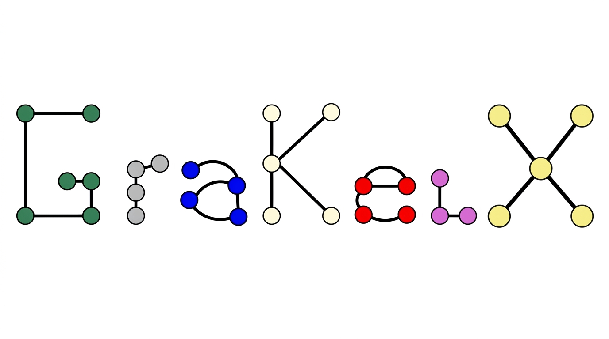

<p align="center">
  
</p>

--------------------------------------------------------------------------------

> [!NOTE]
> **grakelx** is an independent fork of [GraKeL](https://github.com/ysig/GraKeL) by Siglidis, Nikolentzos, Limnios, Giatsidis, Skianis, and Vazirgiannis,
> originally published in JMLR 2020. This fork continues maintenance and development under the **BSD 3-clause** license.
> See [LICENSE](LICENSE) and the [Acknowledgements](#acknowledgements) section below.

[](https://pypi.org/pypi/grakelx/)

**[Documentation](https://SneachChea.github.io/GraKelX/)** | **[Paper](http://jmlr.org/papers/volume21/18-370/18-370.pdf)**

*grakelx* is a library that provides implementations of several well-established graph kernels. The library unifies these kernels into a common framework. Furthermore, it provides implementations of some frameworks that work on top of graph kernels. Specifically, grakelx contains 16 kernels and 3 frameworks. The library is compatible with the [scikit-learn](http://scikit-learn.org/) pipeline allowing easy and fast integration inside machine learning algorithms.

--------------------------------------------------------------------------------

In detail, the following kernels and frameworks are currently implemented:

* **[Vertex histogram kernel](https://SneachChea.github.io/GraKelX/latest/generated/grakelx.VertexHistogram.html)**
* **[Edge histogram kernel](https://SneachChea.github.io/GraKelX/latest/generated/grakelx.EdgeHistogram.html)**
* **[Shortest path kernel](https://SneachChea.github.io/GraKelX/latest/generated/grakelx.ShortestPath.html)** from Borgwardt and Kriegel: [Shortest-path kernels on graphs](https://www.dbs.ifi.lmu.de/~borgward/papers/BorKri05.pdf) (ICDM 2005)
* **[Graphlet kernel](https://SneachChea.github.io/GraKelX/latest/generated/grakelx.GraphletSampling.html)** from Shervashidze *et al.*: [Efficient graphlet kernels for large graph comparison](http://proceedings.mlr.press/v5/shervashidze09a/shervashidze09a.pdf) (AISTATS 2009)
* **[Random walk kernel](https://SneachChea.github.io/GraKelX/latest/generated/grakelx.RandomWalk.html)** from Vishwanathan *et al.*: [Graph Kernels](http://www.jmlr.org/papers/volume11/vishwanathan10a/vishwanathan10a.pdf) (JMLR 11(Apr))
* **[Neighborhood hash graph kernel](https://SneachChea.github.io/GraKelX/latest/generated/grakelx.NeighborhoodHash.html)** from Hido and Kashima: [A Linear-time Graph Kernel](https://ieeexplore.ieee.org/abstract/document/5360243) (ICDM 2009)
* **[Weisfeiler-Lehman framework](https://SneachChea.github.io/GraKelX/latest/generated/grakelx.WeisfeilerLehman.html)** from Shervashidze *et al.*: [Weisfeiler-Lehman Graph Kernels](http://www.jmlr.org/papers/volume12/shervashidze11a/shervashidze11a.pdf) (JMLR 12(Sep))
* **[Neighborhood subgraph pairwise distance kernel](https://SneachChea.github.io/GraKelX/latest/generated/grakelx.NeighborhoodSubgraphPairwiseDistance.html)** from Costa and De Grave: [Fast Neighborhood Subgraph Pairwise Distance Kernel](https://pdfs.semanticscholar.org/7a10/f6a406b664d1159e7c4fefbdd6ac275aee53.pdf) (ICML 2010)
* **[Lovasz-theta kernel](https://SneachChea.github.io/GraKelX/latest/generated/grakelx.LovaszTheta.html)** from Johansson *et al.*: [Global graph kernels using geometric embeddings](http://proceedings.mlr.press/v32/johansson14.pdf) (ICML 2014)
* **[SVM-theta kernel](https://SneachChea.github.io/GraKelX/latest/generated/grakelx.SvmTheta.html)** from Johansson *et al.*: [Global graph kernels using geometric embeddings](http://proceedings.mlr.press/v32/johansson14.pdf) (ICML 2014)
* **[Ordered decompositional DAG kernel](https://SneachChea.github.io/GraKelX/latest/generated/grakelx.OddSth.html)** from Da San Martino *et al.*: [A Tree-Based Kernel for Graphs](https://pdfs.semanticscholar.org/69ee/18dd7a214d4d656b5b95742212f050dabeac.pdf) (SDM 2012)
* **[GraphHopper kernel](https://SneachChea.github.io/GraKelX/latest/generated/grakelx.GraphHopper.html)** from Feragen *et al.*: [Scalable kernels for graphs with continuous attributes](https://papers.nips.cc/paper/5155-scalable-kernels-for-graphs-with-continuous-attributes.pdf) (NIPS 2013)
* **[Propagation kernel](https://SneachChea.github.io/GraKelX/latest/generated/grakelx.Propagation.html)** from Neumann *et al.*: [Propagation kernels: efficient graph kernels from propagated information](https://link.springer.com/content/pdf/10.1007/s10994-015-5517-9.pdf) (Machine Learning 102(2))
* **[Pyramid match kernel](https://SneachChea.github.io/GraKelX/latest/generated/grakelx.PyramidMatch.html)** from Nikolentzos *et al.*: [Matching Node Embeddings for Graph Similarity](https://www.aaai.org/ocs/index.php/AAAI/AAAI17/paper/view/14494/14426) (AAAI 2017)
* **[Subgraph matching kernel](https://SneachChea.github.io/GraKelX/latest/generated/grakelx.SubgraphMatching.html)** from Kriege and Mutzel: [Subgraph Matching Kernels for Attributed Graphs](https://arxiv.org/ftp/arxiv/papers/1206/1206.6483.pdf) (ICML 2012)
* **[Multiscale Laplacian kernel](https://SneachChea.github.io/GraKelX/latest/generated/grakelx.MultiscaleLaplacian.html)** from Kondor and Pan: [The Multiscale Laplacian Graph Kernel](https://papers.nips.cc/paper/6135-the-multiscale-laplacian-graph-kernel.pdf) (NIPS 2016)
* **[Core framework](https://SneachChea.github.io/GraKelX/latest/generated/grakelx.CoreFramework.html)** from Nikolentzos *et al.*: [A Degeneracy Framework for Graph Similarity](https://www.ijcai.org/proceedings/2018/0360.pdf) (IJCAI 2018)
* **[Weisfeiler-Lehman optimal assignment kernel](https://SneachChea.github.io/GraKelX/latest/generated/grakelx.WeisfeilerLehmanOptimalAssignment.html)** from Kriege *et al.*: [On Valid Optimal Assignment Kernels and Applications to Graph Classification](http://papers.nips.cc/paper/6166-on-valid-optimal-assignment-kernels-and-applications-to-graph-classification.pdf) (NIPS 2016)

--------------------------------------------------------------------------------

To learn how to install and use grakelx, and to find out more about the implemented kernels and frameworks, please read our [documentation](https://SneachChea.github.io/GraKelX/). To learn about the functionality of the library and about example applications, check out our [examples](https://github.com/SneachChea/GraKelX/tree/master/examples) in the `examples/` directory.

In case you find a bug, please open an [issue](https://github.com/SneachChea/GraKelX/issues). To propose a new kernel, you can open a [feature request](https://github.com/SneachChea/GraKelX/issues).

## Installation

grakelx requires the following packages to be installed:

* Python (>=3.10)
* NumPy (>=1.23.0)
* SciPy (>=1.8.0)
* Cython (>=0.29.36)
* cvxopt (>=1.2.0) [optional]
* future (>=0.16.0)

To install the package, run:

```sh
pip install grakelx
```

For local development with uv:

```sh
uv sync --group test
uv run python setup.py build_ext --inplace
uv run pre-commit install
```

## Running tests

To test the package, execute:

```sh
uv run pytest
```

## Running examples

```
cd examples
python shortest_path.py
```

## Cite

If you use grakelx in a scientific publication, please cite the original GraKeL paper (<http://jmlr.org/papers/volume21/18-370/18-370.pdf>):

```bibtex
@article{JMLR:v21:18-370,
  author  = {Giannis Siglidis and Giannis Nikolentzos and Stratis Limnios and Christos Giatsidis and Konstantinos Skianis and Michalis Vazirgiannis},
  title   = {GraKeL: A Graph Kernel Library in Python},
  journal = {Journal of Machine Learning Research},
  year    = {2020},
  volume  = {21},
  number  = {54},
  pages   = {1-5}
}
```

## License

grakelx is distributed under the **BSD 3-clause** license (same as the original GraKeL). The library makes use of the C++ source code of [BLISS](http://www.tcs.hut.fi/Software/bliss) (a tool for computing automorphism groups and canonical labelings of graphs) which is **LGPL** licensed. Furthermore, the [cvxopt](https://cvxopt.org/) package (a software package for convex optimization) which is an optional dependency of grakelx is **GPL** licensed.

## Acknowledgements

We would like to thank [@eddiebergman](https://github.com/eddiebergman) for modernizing the original GraKeL CI and extending Python support.

This project is a fork of [GraKeL](https://github.com/ysig/GraKeL) by Giannis Siglidis, Giannis Nikolentzos, Stratis Limnios, Christos Giatsidis, Konstantinos Skianis, and Michalis Vazirgiannis, originally published in JMLR 2020 ([paper](http://jmlr.org/papers/volume21/18-370/18-370.pdf)). The original copyright holders are the GraKeL developers. All modifications and additions in this fork are released under the same **BSD 3-clause** license.
